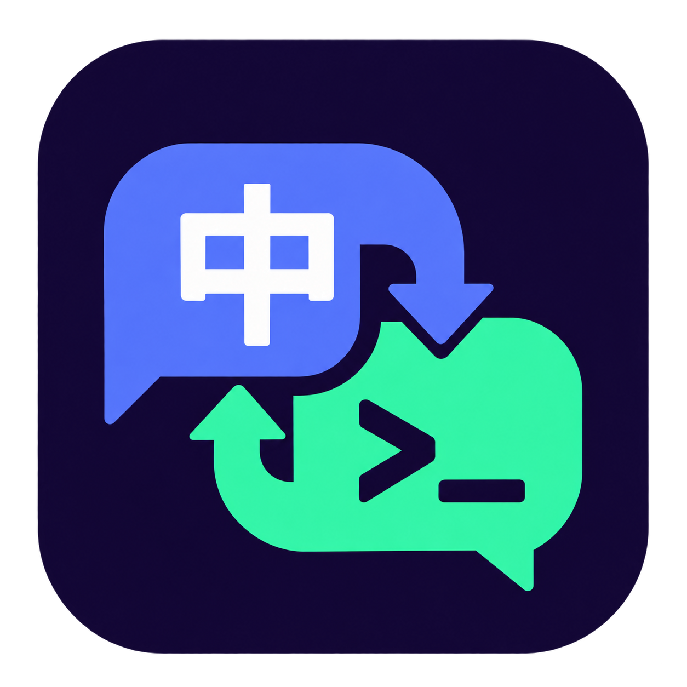

<p align="center">
  
</p>

<h1 align="center">ContextIME</h1>

<p align="center">
  <strong>Chinese for chat. English for the terminal.</strong><br>
  Fewer input-method switches. Fewer interruptions.
</p>

<p align="center">
  Focus-aware input switching for AI-assisted coding in VS Code on Windows.
</p>

<p align="center">
  <a href="https://marketplace.visualstudio.com/items?itemName=ContextIME.codex-terminal-auto-input"></a>
  
  <a href="LICENSE"></a>
</p>

<p align="center">
  <a href="https://marketplace.visualstudio.com/items?itemName=ContextIME.codex-terminal-auto-input"><strong>Install from the Marketplace</strong></a>
  &nbsp;·&nbsp;
  <a href="#getting-started">Get started</a>
  &nbsp;·&nbsp;
  <a href="#make-it-yours">Settings</a>
  &nbsp;·&nbsp;
  <a href="https://github.com/Howzits/ContextIME/issues">Report an issue</a>
</p>

<p align="center">
  <a href="README.md">简体中文</a> / <strong>English</strong>
</p>

---

## From describing a change to running a command

Just finished chatting with an AI assistant in Chinese, switched to the terminal, and typed `git status`—only to see a pinyin candidate list?

ContextIME requests the appropriate input mode when focus moves between inputs. A typical workflow looks like this:

```text
Chat: describe a task and add context  → Chinese
Terminal: run commands and tests      → English
Chat: discuss the results            → Chinese, or that input's saved preference
```

You can still switch languages manually. While focus stays in the same input, ContextIME does not continually override your choice.

Switching depends on the input control's accessibility information and the IME's support for Windows requests. Behavior varies across chat extensions and input methods. See the [compatibility checklist (Chinese)](docs/COMPATIBILITY.md) for tested checks and scenarios still awaiting hands-on verification.

## Keep your input method in step with your work

- **Switch by context.** Request English in the integrated terminal and Chinese in editable chat and dialog inputs, without configuring each AI assistant separately.
- **Use your configured input methods.** Read the Windows default input language and installed layouts rather than forcing a US keyboard or requiring an extra English layout.
- **Remember preferences for individual inputs.** Keep session-scoped preferences, with commands to choose English, Chinese, or no intervention for a specific input.
- **Pause whenever you need to.** Click the status bar item to pause. Code editors, password fields, and read-only controls are left unchanged.
- **Understand missed switches.** Built-in diagnostics help distinguish unrecognized controls, rules that preserve the current mode, and input-method request issues.

## Getting started

Requires **Windows x64, VS Code 1.96+ or VS Code Insiders**, and a configured Chinese input method.

1. Open Extensions (`Ctrl+Shift+X`), search for **ContextIME**, and install the extension published by **ContextIME**. You can also [open its Marketplace page](https://marketplace.visualstudio.com/items?itemName=ContextIME.codex-terminal-auto-input).
2. ContextIME is enabled by default. Look for **ContextIME** in the status bar and reload the window if prompted.
3. Move between a chat input and the integrated terminal. Try typing in both to confirm that switching works with your input method.

Or install from the command line:

```powershell
code --install-extension ContextIME.codex-terminal-auto-input
```

If the extension does not appear in search, use its full ID:

```text
@id:ContextIME.codex-terminal-auto-input
```

No compilation or separate tray application is needed.

**Upgrading from the earlier local build:** uninstall `local-tools.codex-terminal-auto-input` before installing the Marketplace edition to avoid running both extensions. Settings retain the `autoInput.*` prefix. Reload all VS Code windows after migrating.

For offline installation, download the [Marketplace VSIX package](https://github.com/Howzits/ContextIME/raw/refs/heads/main/dist/ContextIME-0.4.1-marketplace-win32-x64.vsix), then choose **Extensions → … → Install from VSIX…**. Earlier GitHub Release assets may use the old `local-tools` publisher; use the Marketplace package when migrating.

## Make it yours

| What you want | What to do |
| --- | --- |
| Chinese in chat and ordinary inputs; English in the terminal | Keep the default settings |
| Leave search boxes and the Command Palette unchanged | Set `autoInput.otherInputs` to `preserve` |
| Prefer English in a particular chat input | Run `autoInput.preferEnglish`, then click that input within 3 seconds |
| Temporarily control the input method yourself | Click ContextIME in the status bar to pause |

Command titles currently appear in Chinese. Search the Command Palette for **ContextIME**; command IDs below identify their corresponding actions, not text to paste into a terminal.

| Command ID | Action |
| --- | --- |
| `autoInput.toggle` | Pause or enable automatic switching |
| `autoInput.preferEnglish` / `autoInput.preferChinese` | Remember English or Chinese for the input selected within 3 seconds |
| `autoInput.preferKeep` | Leave the selected input's mode unchanged |
| `autoInput.clearPreferences` | Clear session preferences |
| `autoInput.diagnose` | Inspect the input selected within 3 seconds |
| `autoInput.showLog` / `autoInput.restart` | Show logs or restart the helper |

Available settings:

```json
{
  "autoInput.enabled": true,
  "autoInput.rememberPreferences": true,
  "autoInput.otherInputs": "chinese",
  "autoInput.pollInterval": 250
}
```

Preferences are stored only for the current helper session, up to 128 controls. They may be lost when a control is recreated or the helper restarts. Automatic learning depends on observable IME state changes; use the preference commands if that state cannot be read reliably. The `preserve` option may also skip third-party chat inputs that do not expose recognizable chat markers. The polling interval accepts 150–1000 ms; actual switching latency varies.

Detailed implementation and developer instructions are available in the [usage guide (Chinese)](docs/USAGE.md).

## Frequently asked questions

**Does it read my code or chat messages?**

No. ContextIME does not read code contents, chat messages, or input values. It does not listen for keystrokes, make network requests, or upload telemetry. Classification uses the focused control's type and structural identifiers. Diagnostic logs stay in the local VS Code output panel.

**Which chat extensions work?**

Classification is based on input controls rather than a particular chat brand. Inputs exposing standard accessibility information are the primary target; support for every extension is not guaranteed. See the [compatibility checklist (Chinese)](docs/COMPATIBILITY.md) for the current verification status.

**Why does the status bar show a Chinese target while I still type English?**

The status bar reports the requested target, not a verified input state. Some IMEs ignore cross-process requests. Run the ContextIME diagnostic command, then click the target input within 3 seconds. If the control is not recognized, you can try setting `editor.accessibilitySupport` to `on` and reloading; ContextIME does not change that setting automatically. If requests are sent but switching does not happen, confirm that manual switching works with your IME.

**Does it work on macOS, Linux, or in other applications?**

The current version targets desktop VS Code on Windows. It does not switch input methods system-wide. SSH and WSL workspaces opened from Windows use the local UI-side helper by design, but those workflows still need hands-on verification.

## Help improve the experience

Found an input that does not switch as expected? [Open an issue](https://github.com/Howzits/ContextIME/issues) with your Windows, VS Code, chat-extension, and input-method versions, along with the diagnostic result. You do not need to include chat contents.

Source code, build scripts, and a [compatibility-checking procedure (Chinese)](docs/COMPATIBILITY.md) are included. Contributions and real-world compatibility reports are welcome.

[Install from the Marketplace](https://marketplace.visualstudio.com/items?itemName=ContextIME.codex-terminal-auto-input) · [GitHub Releases](https://github.com/Howzits/ContextIME/releases) · [Changelog](CHANGELOG.md)

## License

[MIT](LICENSE). Independent project; not affiliated with any AI assistant vendor.
