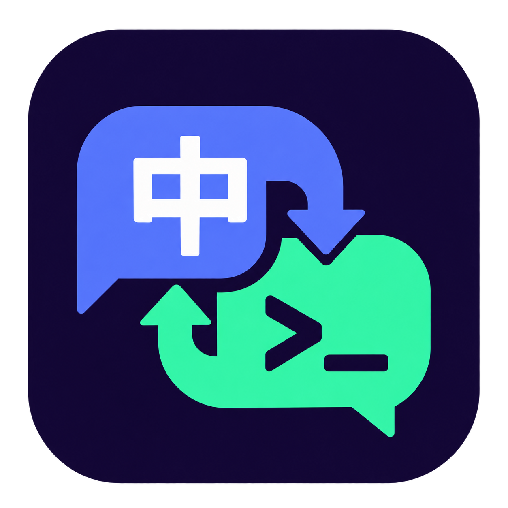

# ContextIME

**聊天中文，终端英文。少切一次输入法，少打断一次思路。**

用中文向 AI 描述需求，转到终端跑一条命令，再回到聊天框讨论结果——ContextIME 根据输入焦点请求切换中英文，让你少惦记一次输入法。

为 **Windows 上的 VS Code 用户**设计，适合经常在 AI 聊天和集成终端之间往返的开发者。

**[下载 ContextIME v0.4.0](https://github.com/Howzits/ContextIME/releases/download/v0.4.0/ContextIME-0.4.0.vsix)** · [安装与使用](#安装与使用) · [配置指南](docs/USAGE.md) · [反馈问题](https://github.com/Howzits/ContextIME/issues)

## 从描述需求到执行命令，衔接更顺手

你是否也遇到过：刚用中文和 AI 聊完，点开终端输入 `git status`，出来的却是拼音候选词？

ContextIME 把输入法切换放在焦点变化时处理。典型使用流程是：

```text
聊天框：描述需求、补充上下文     → 中文
终  端：执行命令、运行测试       → 英文
聊天框：讨论结果、继续修改       → 中文，或该输入框已记住的偏好
```

切换后仍可手动选择中英文。在同一个输入框里，扩展不会持续把你的选择改回去。

> 目前为早期版本。自动切换依赖控件的辅助功能信息和输入法对 Windows 请求的支持；不同聊天插件、输入法的实际效果可能不同，详见[兼容性记录](docs/COMPATIBILITY.md)。

## 为什么试试 ContextIME？

- **围绕你的工作流切换。** 集成终端默认英文，聊天和对话框的可编辑输入区域默认中文，无需针对每个 AI 助手单独设置。
- **沿用你习惯的输入法。** 读取 Windows 默认输入语言和已安装布局，不写死美式键盘，也不要求额外安装英语键盘。
- **让不同输入框保留不同偏好。** 支持当前会话内的偏好记忆；可以明确指定某个输入框使用英文、中文或保持不变。
- **需要时，随时暂停。** 点击状态栏即可暂停。代码编辑区、密码框和只读控件保持当前输入法。
- **切换有疑问，可以查原因。** 自带输入框诊断，帮助区分控件未识别、规则保持和输入法请求问题。

## 安装与使用

需要 **Windows x64、VS Code 1.96+ 或 VS Code Insiders**，以及已配置的中文输入法。

1. [下载已编译的 VSIX 安装包](https://github.com/Howzits/ContextIME/releases/download/v0.4.0/ContextIME-0.4.0.vsix)，无需自行编译。
2. 打开 VS Code 扩展视图，点击右上角 `… → 从 VSIX 安装…`，选择下载的文件。
3. 必要时运行 `Developer: Reload Window`；升级后建议重载所有 VS Code 窗口。
4. 在聊天输入框和集成终端之间切换，分别试打中文和英文。

安装后默认启用，状态栏显示 **ContextIME**。不需要另开托盘程序。当前提供本地 VSIX 下载，尚未发布到插件市场。

## 按你的习惯调整

| 你想要的体验 | 怎样设置 |
| --- | --- |
| 聊天、普通输入框用中文，终端用英文 | 保持默认设置 |
| 搜索框、命令面板等区域保持原样 | 将 `autoInput.otherInputs` 设为 `preserve` |
| 某个聊天框更常使用英文 | 运行“此输入框记住英文”命令，并在 3 秒内点击该输入框 |
| 暂时手动控制输入法 | 点击状态栏暂停 ContextIME |

偏好只保存在当前助手会话中，控件重建或助手重启后可能失效。自动记忆取决于输入法状态能否被读取；不可靠时可用命令明确指定。`preserve` 模式也可能跳过没有暴露聊天标识的第三方输入框。

完整设置、命令和开发说明见[使用指南](docs/USAGE.md)。

## 关心的几个问题

**会读取我的代码或聊天内容吗？**

不会读取代码正文、聊天内容或输入值，不监听按键，不联网，也不上传遥测。识别基于焦点控件的类型和结构标识；诊断日志留在本机的 VS Code 输出面板。

**支持哪些聊天插件？**

识别依据是输入控件，不绑定某个聊天品牌。暴露标准可访问输入控件的界面是主要适配目标；目前还不能承诺所有插件都能切换，具体实测状态见[兼容性记录](docs/COMPATIBILITY.md)。

**状态栏显示“目标 中”，为什么仍然输入英文？**

“目标”表示已发出请求，不是已验证的输入状态。部分输入法会忽略跨进程切换请求。运行 `ContextIME: 诊断输入框（3 秒后采集）`，在 3 秒内点回目标输入框，查看诊断结果；更多步骤见[故障排查](docs/USAGE.md#没有自动切换)。

**支持 macOS、Linux 或其他应用吗？**

当前版本面向 Windows 桌面版 VS Code，只处理其内部输入区域，不提供系统全局切换。

## 一起把切换体验做好

如果遇到某个输入框没有切换，欢迎[提交 Issue](https://github.com/Howzits/ContextIME/issues)，附上 Windows、VS Code、聊天插件和输入法版本，以及诊断结果即可，不需要提供聊天正文。

项目提供源码、编译脚本和[兼容性检查方法](docs/COMPATIBILITY.md)，也欢迎贡献适配和实测结果。

[下载试用](https://github.com/Howzits/ContextIME/releases/download/v0.4.0/ContextIME-0.4.0.vsix) · [历史版本](https://github.com/Howzits/ContextIME/releases) · [查看更新](CHANGELOG.md)

## English

**Chinese for chat. English for the terminal. Fewer input-method interruptions.**

ContextIME requests IME changes as you move between chat inputs and the integrated terminal in Windows VS Code. It uses configured Windows input methods, supports session-scoped input preferences, and leaves code editors and password fields unchanged. Accessibility and IME support vary; a requested state is not a verified input state.

[Download the VSIX](https://github.com/Howzits/ContextIME/releases/download/v0.4.0/ContextIME-0.4.0.vsix) · [Compatibility](docs/COMPATIBILITY.md)

## License

[MIT](LICENSE). Independent project; not affiliated with any AI assistant vendor.
